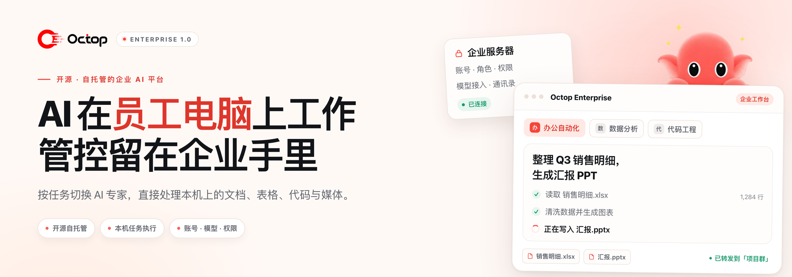
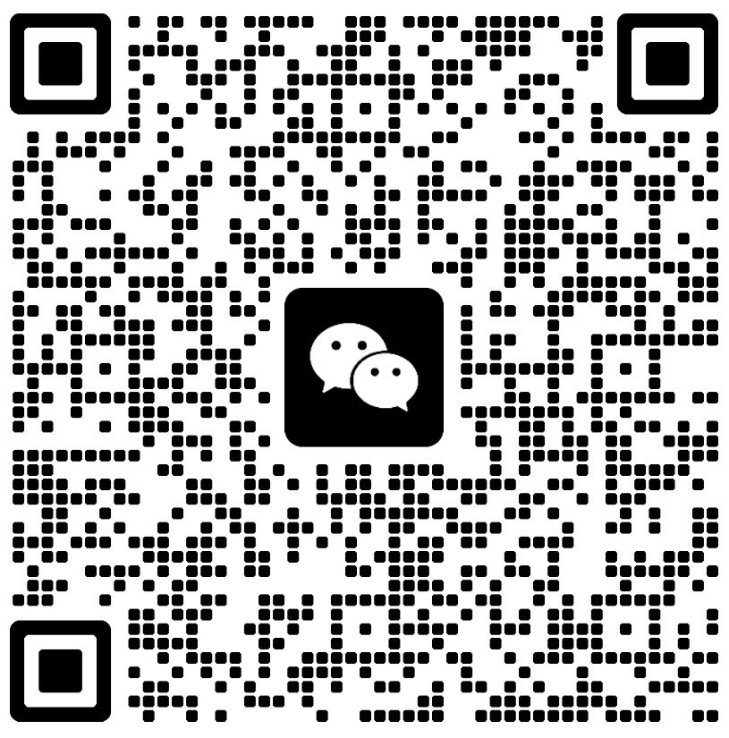

<picture>
  <source media="(prefers-color-scheme: dark)" srcset="docs/assets/readme-hero-zh-dark.png">
  
</picture>

<h1>Octop Enterprise</h1>

<strong>AI 在员工电脑上工作，账号、模型与权限留在企业手里。</strong>

  
  
  
  
  

  <a href="docker/enterprise/README.md">企业部署</a> ·
  <a href="docs/enterprise-client.md">客户端使用</a> ·
  <a href="docs/user-guide.md">员工上手</a> ·
  <a href="CONTRIBUTING.md">参与开发</a> ·
  <a href="README_EN.md">English</a>

基于 <a href="https://github.com/TencentCloud/Octop">TencentCloud/Octop</a> 二次开发 · 由 <a href="https://github.com/colorAi/Octop-Enterprise">Octop Enterprise 维护者</a> 独立维护 · 非腾讯官方版本

开源、自托管的企业 AI 工作与协作平台。每位员工都能按任务切换 AI 专家，让 AI 在本机读写文档、表格与代码，处理图像和音视频；再通过企业通讯录、私聊和群组，把成果转发给同事。项目文件保存在员工自己的电脑上，账号、模型与权限由企业统一管理。

## 为什么选择 Octop Enterprise

| 给员工                                                                                                        | 给企业 IT                                                                                                    | 给团队                                                                                                                  |
| :------------------------------------------------------------------------------------------------------------ | :----------------------------------------------------------------------------------------------------------- | :---------------------------------------------------------------------------------------------------------------------- |
| **一个工作台，按任务切换专家** 文档、表格、代码和媒体在同一个窗口里完成，成果直接落回项目目录。             | **账号、模型与权限集中管理** 员工不必各自申请模型密钥；管理员按角色授权，随时调整使用范围。                | **成果在通讯录、私聊和群组之间流动** 把 AI 产出转给同事，或交给另一个专家继续处理。                                     |

## 功能一览

| 工作                                                                                                                                                                                                                                     | 协作                                                                                                                                                                                                 | 管理与部署                                                                                                                                                                                                                                         |
| :--------------------------------------------------------------------------------------------------------------------------------------------------------------------------------------------------------------------------------------- | :--------------------------------------------------------------------------------------------------------------------------------------------------------------------------------------------------- | :------------------------------------------------------------------------------------------------------------------------------------------------------------------------------------------------------------------------------------------------ |
| **多专家与技能** 按岗位和任务创建或选择专家，共享配置、复用技能。  **本机任务执行** 读写授权目录中的文件，运行 Python 与终端任务，处理表格、生成文档、编写代码。  **图像与媒体** 通过企业配置的服务生成和编辑图像，结合本机工具处理音视频。  **记忆与知识库** 专家持续积累上下文；接入企业文档知识库，让回答结合内部资料。 | **企业通讯录** 按组织架构找到同事，查看在线状态。  **私聊与群组** 公司总群、部门群、项目群，支持文字、图片和文件。  **消息与成果转发** 在专家对话、私聊和群组之间转发消息与文件；把 AI 产出交给同事或其他专家。 | **账号与权限** 多用户、组织架构、角色与功能授权。  **统一模型服务** 接入内网或外部模型及图像服务，集中配置、按需授权。  **私有化部署** 自行部署和管理服务、账号、会话与知识资料，提供服务端工作区隔离及备份恢复工具。  **服务端扩展** 定时任务、多平台 IM 通道、连接器（OAuth + MCP）、插件与 ACP 编程工具集成。 |

服务端扩展（定时任务、多平台 IM 通道、连接器、插件与 ACP）受部署、权限和隔离策略限制；本机客户端不加载外部连接器或 ACP。详见[企业客户端指南](docs/enterprise-client.md)。

## 适用场景

- **办公与资料整理**：整理表格、汇总资料、生成报告和日常文档。
- **研发与项目处理**：围绕本机代码和文件开展开发、运行项目脚本、分析日志与排查问题。
- **内容与素材制作**：生成或修改图像，处理音视频素材，将产出保存在项目目录。
- **团队知识与协作**：复用团队沉淀的专家与技能，检索企业资料，在同事与群组之间交流需求、分享成果。

## 工作方式

| 位置           | 负责                                                     |
| :------------- | :------------------------------------------------------- |
| **企业服务器** | 账号与权限、模型接入、专家配置、长期记忆、会话和内部通信 |
| **员工电脑**   | 执行任务工具，保存和处理本机项目文件与成果               |
| **模型服务**   | 提供企业配置的内网或外部模型推理、图像生成等能力         |

> [!NOTE]
> 本机执行仍需连接企业服务及其配置的模型，任务上下文和工具结果会按需发送给这些服务。本机工具使用员工的系统权限，项目目录不是操作系统沙箱；跨设备查看历史不会自动同步项目文件。数据边界与使用限制见[客户端指南](docs/enterprise-client.md)。

## 快速开始

当前版本：**1.0.1b2**。服务端从本仓库源码构建，Windows/macOS 员工客户端可从 [Releases](https://github.com/colorAi/Octop-Enterprise/releases) 下载匹配的安装包。

| 管理员：部署与配置                                                                                                                                                                    | 员工：登录与工作                                                                                                                              |
| :------------------------------------------------------------------------------------------------------------------------------------------------------------------------------------ | :-------------------------------------------------------------------------------------------------------------------------------------------- |
| 1. 准备 **Linux + Docker Engine + Docker Compose** 主机。 2. 按[部署指南](docker/enterprise/README.md)完成首次安装与初始化。 3. 配置模型、账号、角色，并准备员工可用的专家。 4. 分发匹配的客户端，先验证一名员工的完整流程。 | 1. 安装企业客户端，填写管理员提供的服务器地址。 2. 使用企业账号登录，确认“本地工作目录”。 3. 选择专家，描述要处理的文件或项目。 4. 查看成果，转发给同事、群组或其他专家。 |

客户端构建见[桌面说明](desktop/README.md)，详细操作见[企业客户端指南](docs/enterprise-client.md)。

## 文档

| 文档                                                                                            | 内容                                     |
| :---------------------------------------------------------------------------------------------- | :--------------------------------------- |
| [企业部署与恢复](docker/enterprise/README.md)                                                   | 服务准备、首次安装、升级、备份和恢复     |
| [员工快速上手](docs/user-guide.md)                                                              | 首次登录、专家和日常操作                 |
| [企业客户端指南](docs/enterprise-client.md)                                                     | 员工使用、任务与成果、支持范围和数据边界 |
| [参与开发](CONTRIBUTING.md) / [桌面构建](desktop/README.md)（English）                                     | 开发环境、源码构建和客户端打包           |
| [架构](docs/architecture.md)（English）/ [API](docs/api.md)（English）/ [通信服务](services/communication/README.md)（English） | 系统结构、接口与企业通信                 |
| [更新说明](docs/updates.md)                                                                     | 配置变更、服务器升级与客户端更新         |

开发、API 与桌面构建类文档当前以英文维护；员工与部署文档提供中英文两版。

## 交流群

**Octop 企业版交流群**。扫码加入。

<picture>
  <source media="(prefers-color-scheme: dark)" srcset="docs/assets/community/octop-group-dark-20261018.jpg">
  
</picture>

## 开源与致谢

主项目和自有通信模块采用 [MIT License](LICENSE)，保留 Octop 的原始版权和许可声明。第三方依赖、素材与模板遵循各自许可证；公开源码的分发范围见 [NOTICE](NOTICE.md)。

感谢 [Octop](https://github.com/TencentCloud/Octop) 及其贡献者，以及 Octop Harness、Gateway、Memory 等项目和开源社区。问题与建议请提交到[本仓库 Issues](https://github.com/colorAi/Octop-Enterprise/issues)；安全问题请按 [SECURITY.md](SECURITY.md) 私密报告。
