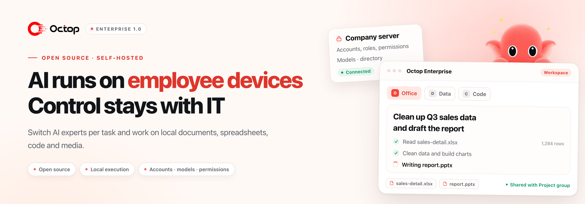

<picture>
  <source media="(prefers-color-scheme: dark)" srcset="docs/assets/readme-hero-en-dark.png">
  
</picture>

<h1>Octop Enterprise</h1>

<strong>AI runs on employee devices. Accounts, models and permissions stay with IT.</strong>

  
  
  
  
  

  <a href="docker/enterprise/README_EN.md">Deployment</a> ·
  <a href="docs/enterprise-client_EN.md">Employee guide</a> ·
  <a href="docs/user-guide_EN.md">Quick start</a> ·
  <a href="CONTRIBUTING_EN.md">Contributing</a> ·
  <a href="README_CN.md">中文</a>

Based on <a href="https://github.com/TencentCloud/Octop">TencentCloud/Octop</a> · Independently maintained by <a href="https://github.com/colorAi/Octop-Enterprise">the Octop Enterprise maintainers</a> · Not an official Tencent edition

An open-source, self-hosted AI work and collaboration platform. Every employee can switch AI experts per task and have them work directly on local documents, spreadsheets, code, images, audio and video; results travel to colleagues through the company directory, direct messages and groups. Project files stay on the employee&rsquo;s computer, while accounts, models and permissions remain under company control.

## Why Octop Enterprise

| For employees                                                                                                                       | For IT                                                                                                                                | For teams                                                                                                                       |
| :---------------------------------------------------------------------------------------------------------------------------------- | :------------------------------------------------------------------------------------------------------------------------------------ | :------------------------------------------------------------------------------------------------------------------------------ |
| **One workspace, an expert per task** Documents, spreadsheets, code and media in one window, with results landing back in the project folder. | **Accounts, models and permissions in one place** No provider keys to manage per employee; admins grant access by role and adjust scope anytime. | **Results move through the directory, DMs and groups** Forward AI output to a colleague, or hand it to another expert.        |

## Capabilities

| Work                                                                                                                                                                                                                                                                                                                       | Collaboration                                                                                                                                                                                                                                    | Administration and deployment                                                                                                                                                                                                                                                                                                     |
| :------------------------------------------------------------------------------------------------------------------------------------------------------------------------------------------------------------------------------------------------------------------------------------------------------------------------- | :----------------------------------------------------------------------------------------------------------------------------------------------------------------------------------------------------------------------------------------------- | :-------------------------------------------------------------------------------------------------------------------------------------------------------------------------------------------------------------------------------------------------------------------------------------------------------------------------------- |
| **Experts and reusable skills** Create or choose experts by role and task, share configurations and reuse skills.  **Local task execution** Read and write authorized project files, run Python and terminal tasks, process spreadsheets, create documents and write code.  **Image and media** Generate and edit images through company-configured services; process audio and video with local tools.  **Memory and knowledge** Experts keep working context; connect company knowledge bases to ground answers in internal material. | **Company directory** Find colleagues by organization and see who is online.  **Direct messages and groups** Company, department and project groups with text, images and files.  **Message and result sharing** Forward messages and files between conversations; hand AI output to a colleague or another expert. | **Accounts and permissions** Multiple users, organization structure, roles and feature access.  **Central model services** Connect internal or external language and image services, configured once and granted by role.  **Self-hosted deployment** Operate services, accounts, conversations and knowledge yourself, with server workspace isolation plus backup and recovery tools.  **Server extensions** Scheduled tasks, multi-platform IM channels, connectors (OAuth + MCP), plugins and ACP coding-tool integration. |

Server extensions (scheduled tasks, multi-platform IM channels, connectors, plugins and ACP) depend on deployment, permissions and isolation policy; the local client does not load external connectors or ACP. See the [employee guide](docs/enterprise-client_EN.md).

## Use cases

- **Office work and research**: organize spreadsheets, summarize material, and produce reports and everyday documents.
- **Development and project work**: work with local code and files, run project scripts, analyze logs and troubleshoot.
- **Content and media production**: generate or edit images, process audio and video, and keep results in the project folder.
- **Team knowledge and collaboration**: reuse experts and skills, search company material, and discuss or share results with colleagues and groups.

## How it works

| Location          | Responsibility                                                                                                        |
| :---------------- | :-------------------------------------------------------------------------------------------------------------------- |
| **Company server** | Accounts and permissions, model access, expert configurations, long-term memory, conversations and internal messaging |
| **Employee computer** | Task tools and local project files and results                                                                        |
| **Model services**  | Company-configured internal or external inference, image generation and related capabilities                          |

> [!NOTE]
> Local execution still connects to company services and their configured models; task context and tool results are sent to these services as needed. Local tools run with the employee&rsquo;s OS permissions, and a project folder is not an OS sandbox. Viewing history across devices does not synchronize project files. See the [employee guide](docs/enterprise-client_EN.md) for data boundaries and limitations.

## Getting started

Current version: **1.0.0**. This repository provides source code for the server and Windows/macOS enterprise clients, both built from this repository.

| Administrator: deploy and configure                                                                                                                                                                                                                  | Employee: sign in and work                                                                                                                                                                     |
| :--------------------------------------------------------------------------------------------------------------------------------------------------------------------------------------------------------------------------------------------------- | :--------------------------------------------------------------------------------------------------------------------------------------------------------------------------------------------- |
| 1. Prepare a **Linux + Docker Engine + Docker Compose** host. 2. Follow the [deployment guide](docker/enterprise/README_EN.md) to initialize services, databases and the communication service. 3. Configure models, accounts and roles, and prepare experts for employees. 4. Distribute matching clients and validate one employee end to end. | 1. Install the company client and enter the server address from your administrator. 2. Sign in with your company account and confirm the local working folder. 3. Choose an expert and describe the file or project task. 4. Review the result and share it with colleagues, groups or another expert. |

For client builds see the [desktop instructions](desktop/README.md); for detailed steps see the [employee guide](docs/enterprise-client_EN.md).

## Documentation

| Document                                                                                                              | Contents                                                    |
| :-------------------------------------------------------------------------------------------------------------------- | :---------------------------------------------------------- |
| [Deployment and recovery](docker/enterprise/README_EN.md)                                                                | Prerequisites, installation, upgrades, backups and recovery |
| [Employee quick start](docs/user-guide_EN.md)                                                                            | First login, experts and everyday tasks                     |
| [Employee guide](docs/enterprise-client_EN.md)                                                                           | Tasks, results, supported scope and data boundaries         |
| [Contributing](CONTRIBUTING_EN.md) / [Desktop builds](desktop/README.md)                                                 | Development setup, source builds and client packaging       |
| [Architecture](docs/architecture.md) / [API](docs/api.md) / [Communication service](services/communication/README.md) | System structure, interfaces and company messaging          |
| [Update procedures](docs/updates_EN.md)                                                                                  | Configuration changes, server upgrades and client updates   |

## License and acknowledgments

The application and our communication service use the [MIT License](LICENSE), retaining Octop&rsquo;s original copyright and license notices. Third-party dependencies, assets and templates retain their own terms. See [NOTICE](NOTICE_EN.md) for the public source distribution scope.

Thanks to [Octop](https://github.com/TencentCloud/Octop) and its contributors, Octop Harness, Gateway, Memory and the wider open-source community. File ordinary issues in [this repository](https://github.com/colorAi/Octop-Enterprise/issues); report vulnerabilities privately according to [SECURITY.md](SECURITY_EN.md).
