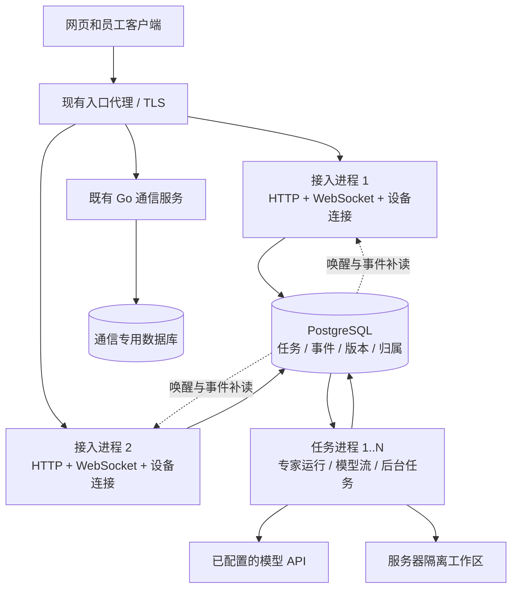

# 企业版多进程并发设计

状态：设计提案，尚未实现或切换部署。设计基线为 4 核 4GB，覆盖 8 核 8GB、8 核 16GB。进程数量是起步配置，承载人数由后续压测确定。本文不以当前 H3C 服务器规格作为部署前提。

## 1. 目标和边界

目标是在多人同时在线、聊天和执行任务时，管理页面、登录、授权变更和取消操作仍能及时响应；超过执行容量时明确排队或拒绝，保持数据和任务状态正确。

分别衡量在线连接数、每秒请求数、并行任务数、并行模型请求数，不能用注册账号数代替容量。4GB/8GB/16GB 指整个 Octop 基础栈的主机内存，包括操作系统、容器引擎、Python、Go 通信服务和 PostgreSQL。额外部署的大模型推理、浏览器集群、向量服务等要另计资源。员工电脑上的本地工具继续在员工电脑执行。

安全封堵、管理性能和多进程的统一实施顺序与完成条件见 [企业版更新计划](enterprise-update-plan.md)。

第一阶段解决单机多进程和进程故障恢复；整个物理机、PostgreSQL 和入口代理的高可用另行设计。暂不增加 Kubernetes、Kafka、Celery 等部署前提。保留现有 Docker Compose 交付方式。

## 2. 现有实现的阻塞和共享状态

当前主入口 `src/octop/launch.py` 先启动完整 `OctopServer`，再构造 Uvicorn Server 并直接调用 `serve()`。CLI 虽有 `--workers` 参数，这条路径没有运行多进程监督器；仅把数值写入 Config 不能完成进程改造。

当前必须处理的状态如下。

| 位置 | 现状 | 多进程后必须保证 |
| --- | --- | --- |
| `infra/server.py::_boot_runtime` | API 启动同时启动专家、调度、渠道、身份投递等 | 按角色启动，接入进程不启动整套运行时 |
| `api/routers/agents.py::list_agents` | 同步逐专家检查容器中的初始化标记 | 列表只读投影，不逐个访问 Docker |
| `infra/users/employee_resources.py` | 配置修订读取真实定义和技能字节 | 发布时算摘要，读路径只查版本；撤权语义保持 |
| `infra/agents/manager.py` | 专家注册表、生命周期锁、会话执行锁、活跃计数在内存中 | 明确运行时归属，跨进程唯一执行与重载协调 |
| `infra/gateway/ws/ws_hub.py` | 连接、用户订阅、活跃会话在本进程 | 任意接入进程都可找到任务和连接，重连可补事件 |
| `infra/gateway/steer/coordinator.py` | 中途指令和取消状态在内存中 | 指令先持久化，再投递给实际执行者 |
| `infra/devices/manager.py` | 设备 socket、pending Future 和工具任务在内存中 | 设备归属、请求编号、连接代次和结果可核对 |
| `infra/history/trajectory/live.py` | 实时轨迹仅进程内广播 | 多进程投递与断线补读 |
| `infra/cron/manager.py` | 每个实例启动自己的 APScheduler | 同一计划时间只生成一项任务 |
| `infra/users/manager.py` | 进程内账号/权限缓存 | 关键鉴权读当前版本，避免另一个进程保留旧权限 |
| `infra/agents/memory/slim_control.py` | 所有实例写同一个控制端点文件 | 按运行时归属路由，不覆盖另一个进程的端点 |

实测现有服务：7 个账号单独读取约 6ms；13 个专家的列表约 1.0–1.1s，模拟页面并发请求时轻量接口也被拖至约 1.1s。公司架构专家/技能总览约 3s。该结果是定位依据，不是容量压测结果。

多进程拥有各自的内存，增加进程也会增加内存开销；数据库迁移等初始化通常需要只执行一次。参见 [FastAPI 部署概念](https://fastapi.tiangolo.com/deployment/concepts/)。

## 3. 最小可部署架构

使用同一代码库、同一镜像，分成两种应用进程。每个容器一个 Python 进程，由 Compose 管理副本和重启。先保证 4GB 配置能部署，再向上增加副本。

图中的两个数据库可以继续使用同一个 PostgreSQL 实例、不同数据库和角色。Go 通信入口仍按现有认证代理路径接入，不直接暴露内部身份接口。

**接入进程**负责登录、用户/部门/专家元数据、配置版本、任务提交/查询、WebSocket 和设备连接。不启动 Harness，不执行文档处理，不扫描全部工作区。需要运行时的请求经内部调用或持久任务交给任务进程。

**任务进程**负责所属用户的 Harness、受管专家准备、服务器任务、异步模型代理、技能快照读取和必要后台任务。一个进程异步服务多个用户，按需加载专家；不为每个用户或每次任务新建 Python 进程。资源归档、压缩、文档解析等另设有界执行槽。

**调度和后台投递**初期合并到任务进程。各任务进程竞争数据库中的调度领导权，只有当前领导者生成定时任务。投递队列可由多个进程领取，使用各自的租约。无需额外常驻一个 scheduler 容器。

**Go 通信服务**第一阶段保持一个实例；其本身支持并发。这一轮不直接复制它的进程内实时连接注册表。只有压测证明这里成为瓶颈时，再设计它的跨实例广播。

**可选扩展**：连接量较大时，把 WebSocket/设备网关从接入进程独立出来；通知量较大时增加独立 Redis。两者均非 4GB 基础安装的必需组件。

## 4. 三个资源档位

以下是实现阶段的初始预算和并发限制，不代表这些人数/任务数已经实测通过。需先完成进程瘦身和峰值测量，才能宣称对应内存档位受支持。

| 项目 | 4 核 4GB | 8 核 8GB | 8 核 16GB |
| --- | --- | --- | --- |
| 接入进程 | 2 | 2 | 3，必要时测量后增至 4 |
| 任务进程 | 1 | 2 | 3，按实际负载调整 |
| 调度 | 任务进程内单领导者 | 同左 | 同左 |
| HTTP/WS 接入与任务执行 | 分开 | 分开 | 分开，可选再拆连接网关 |
| 初始服务器任务并发上限 | 全局 2 | 全局 4 | 全局 8 |
| 初始重型本机任务槽 | 全局 1 | 全局 1–2 | 全局 2 |
| 初始模型请求上限 | 全局 2 | 全局 4 | 全局 8 |
| 默认通知机制 | PostgreSQL 通知 + 持久事件 | 同左 | 同左，测量后可选 Redis |
| 扩容方式 | 先减少单进程占用 | 增加任务槽/进程 | 按接入、任务、模型分别扩容 |

服务器任务、模型请求、重型任务是不同限制；任务可能等待模型或使用员工电脑工具，不应将三类计数简单相加。模型服务的配额或内存限制可以把上表模型上限进一步调低。上限必须全局生效，不能每个进程各放行一份。

建议的内存预算上界：

| 组件 | 4GB 档 | 8GB 档 | 16GB 档 |
| --- | --- | --- | --- |
| 接入容器合计 | 2 × 384 MiB | 2 × 512 MiB | 3 × 512 MiB |
| 任务容器合计 | 1 × 768 MiB | 2 × 1,280 MiB | 3 × 2,048 MiB |
| PostgreSQL | 512 MiB | 1,024 MiB | 2,048 MiB |
| Go 通信 | 128 MiB | 256 MiB | 512 MiB |
| 入口代理 | 32 MiB | 64 MiB | 64 MiB |
| 系统及容器引擎预留 | 至少 768 MiB | 至少 1,024 MiB | 至少 1,536 MiB |
| 额外余量 | 至少 512 MiB | 至少 1,024 MiB | 至少 2,048 MiB |
| 合计 | 约 3.4 GiB | 约 6.8 GiB | 约 13.6 GiB |

这是分配预算，不是观测到的 RSS。容器硬限制和应用准入阈值要分开，应用应在触及硬限制之前停止领取新任务。4GB 档需以最坏请求体、最长允许上下文和活跃专家数测试；如任一组件不能落入预算，该档位不能验收通过，需继续瘦身或降低任务上限。

全量启动专家、永久保留所有 Harness、无限请求体、无限队列均不允许。只淘汰空闲专家实例；保留数据库、工作区卷和个人历史，空闲容器可停而不删。任务内存预算还需包含子进程，不能靠 swap 维持达标。

## 5. 状态归属和任务领取

PostgreSQL 是任务、授权版本、归属和回执的权威。进程内只保留 socket、当前执行对象和可重建缓存。

建议新增或扩展以下逻辑记录，实施时优先复用现有公司运行时事件、检查点和任务表：

| 记录 | 关键内容 |
| --- | --- |
| `process_nodes` | 节点 ID、角色、启动代次、健康和排空状态 |
| `runtime_ownership` | 用户归属、任务节点、租约到期、单调递增的 fencing token |
| `execution_runs` | 网页/桌面/定时来源，服务端或设备执行，用户/专家/会话，状态，授权版本，幂等键 |
| `execution_jobs` | 待执行项、可领取时间、尝试次数、租约、优先级和用户公平调度信息 |
| 会话执行占用 | 同一用户/专家/会话当前运行项，覆盖网页、桌面、定时任务和人工审批恢复 |
| `tool_calls` | 工具操作编号、设备连接代次、执行回执、已完成或结果未知 |
| 持久事件与 `app_outbox` | 会话序号、事件 ID、取消/配置变更/连接命令及投递状态 |
| 资源快照和版本 | 当前已发布 manifest、源版本、授权版本、删除标记 |
| 模型/配额预留 | 全局请求槽、令牌额度预留、结算和未确认用量 |

接收任务时，在一个短事务中完成必要授权核验、幂等记录、会话占用/排队记录和任务入队，再返回任务 ID。不能先向客户端确认接收、之后才尝试写队列。

同一个 `client_request_id` 在同一用户和操作范围内只产生一项任务；同键不同内容返回冲突。数据库约束是最终保护，本地 Lock 仅作进程内优化。

多个任务进程通过短事务和 `FOR UPDATE SKIP LOCKED` 领取队列项，领取后立刻提交，不在等待模型或工具期间持有数据库事务。PostgreSQL 官方将该选项列为多个消费者处理队列表时可用的方式，不能把跳过锁的结果当成通用一致性查询。参见 [PostgreSQL 17 SELECT](https://www.postgresql.org/docs/17/sql-select.html)。

首期以用户作为运行时归属单位，使同一员工的专家、凭据刷新和协作调用尽量在一个任务进程。多个用户可以由同一进程异步服务。分配参考活跃任务和内存，不能只按账号数量均分；空闲时再迁移归属。共享源专家只读，员工执行使用私有实例。旧版共享可执行对象在迁移完成前固定归属，不能同时在多个任务进程启动。

同一会话串行；不同用户可并行；同一用户的不同会话是否并行还受专家与全局额度约束。排队和处理中间指令保留现有语义，不能为吞吐量同时写同一会话检查点。

## 6. 租约、故障和副作用

使用数据库时钟维护租约，续租和状态提交都检查节点启动代次及 fencing token。失去归属的进程停止领取任务和发起工具请求，旧 token 的检查点、事件和完成提交均被拒绝。

租约解决数据库写入的竞争，不能直接阻止旧进程或已启动的 shell 命令继续写文件。归属超时先进入待确认状态，确认旧执行者已停止、相关工具进程已经结束或被隔离后，才重新打开同一可写工作区及本地 SQLite。后续多机部署前还需单独解决工作区存储和服务器检查点迁移，不能把共享 SQLite 文件当成多机存储。

按失败位置处理：

- 领取前失败：任务仍在队列，其他进程可以领取。
- 已领取但未执行副作用：在 token 和检查点核对后恢复。
- 正在执行外部工具、文件写入或发送请求，结果不明：标记 `unknown`，保留会话占用并向客户端核对；不能自动重放整项任务。
- 已完成但客户端未收到：按任务 ID 和事件序号补读，不再次执行。
- 审批等待：决策持久化；同一审批编号只接受一次有效结论，恢复走同一会话执行占用。

数据库唯一键和幂等回执防止可控制路径的重复提交；不承诺任意外部系统的 exactly-once 副作用。

定时调度使用数据库领导者租约，同时对 `(schedule_id, scheduled_at)` 设置唯一约束。后台身份同步、渠道订阅、主动关怀、备份、证书续期和内存整理都要明确归属；不能在所有接入进程里重复运行。凭据刷新按连接器加跨进程保护，避免同时刷新导致令牌互相覆盖。

## 7. 跨进程 WebSocket、设备和取消

用户可以在任意接入进程建立连接，后续 HTTP 请求也可以到任意进程。负载均衡粘性不是正确性的前提。

socket 留在实际接入进程中。连接归属记录节点 ID、启动代次和心跳；设备重连增加权威连接代次。工具请求和回复包含设备/任务/操作编号与代次，旧连接的迟到回复不能写入新任务。

任务进程先写工具调用/控制命令及 outbox，接入进程从持久记录读取并发送给设备。Future 可以用于本进程等待，但不是唯一事实。接入进程故障后通过设备本地 outbox、调用编号和服务端状态核对；不会因 socket 丢失自动重发可能有副作用的命令。

聊天增量、轨迹和任务状态先按批次写入带序号的事件记录，再通知持有连接的进程。客户端按最后确认序号补读并去重。终态与最终历史投影应有事务一致性，不能先发“完成”再丢失结果。

文本增量按约 50–100ms 或有界字节批量合并，取消、审批、工具结果、错误和终态尽快提交；不为每个 token 单独插入一条数据库记录。设置客户端发送队列、事件页、留存时间和最大积压；慢连接断开后补读，不能让一个慢客户端撑大整个进程内存。

取消先持久化 `cancel_requested` 和版本，再唤醒任务/设备归属者。下一个受控步骤必须核对。已发送的模型请求、运行中的本地命令和既有副作用可能晚于取消确认结束；界面区分“取消已接收”与“执行已停止”。

## 8. 默认不增加 Redis

4GB 基础档复用 PostgreSQL：持久事件/outbox 保存内容，`LISTEN/NOTIFY` 只发送记录编号或版本作为唤醒。每个进程使用一条专用、autocommit 的监听连接，不能将监听连接混入事务连接池，也不能让它长期停在事务内。连接恢复后从持久游标补读，并设有界的低频补查以覆盖断连期间的通知。

`NOTIFY` 在事务提交后送达，适合作为“有变更，请查表”的信号。它不是可重放的任务存储，通知内容不放凭据或完整聊天。参见 [PostgreSQL 17 NOTIFY](https://www.postgresql.org/docs/17/sql-notify.html)。

达到通知/连接瓶颈时，可通过同一个通知适配接口换成独立 Redis，用于唤醒、在线状态和可丢弃缓存。任务与回执仍持久化在 PostgreSQL。Redis Pub/Sub 是至多一次投递，断连可能丢消息，不能把取消、撤权或任务完成仅存在 Pub/Sub 中。参见 [Redis Pub/Sub](https://redis.io/docs/latest/develop/pubsub/)。

不复用其他应用的 Redis；增加 Redis 时必须重新核算内存、故障降级和资源预算。未引入 Redis 的部署也必须具有完整正确性。

## 9. 专家、提示词和技能同步

把当前“查询时扫描全部内容”改成“资源保存时生成不可变快照，读取时比较版本”。保持管理员保存后自动进入同步，不新增用户必须执行的发布步骤。

1. 管理员修改专家字段、定义或技能，通过统一写入服务写入暂存内容；涉及同一资源的所有 API、编辑器和受控工具写入都走这一路径。
2. 一次变更只计算改变文件的摘要，构造包含完整授权技能及附件的 manifest，原子落盘到按内容寻址的只读目录。
3. 文件准备完成后，数据库事务通过 CAS 切换当前 manifest、增加源版本并写 outbox。事务失败的孤立文件后续回收，不能发布半个快照。
4. 配置状态读取源、分配、部门和账号版本，不逐个读取技能脚本。资源准备和下载复用同一不可变快照。
5. 任务执行前，以及后续每个模型/受控工具步骤，读取当前权威版本核验；同一次步骤的重复检查可复用，跨步骤不能依赖未验证的 TTL。
6. 管理员撤权、源资源删除和部门变化增加版本/删除标记并发通知；新调用拒绝旧授权。员工个人会话、USER、MEMORY 和产物仍独立保留。

**不可省略的兼容条件**：现有代码会检测通过其他进程或工作区命令直接修改源文件的情况。仅增加 TTL 缓存会丢失这个保障。改成快照后，已发布目录必须只读；直接文件操作只能编辑草稿，并通过同一变更提交入口生效。未迁移到这条写入边界的旧源，继续使用原来的校验，不能提前启用快速缓存。文件监听和后台补扫只是补救机制，不能承担即时撤权的唯一责任。

部门归属仍以 Go 服务为权威。管理页面可以读取带更新时间的轻量投影；实际保存和执行继续向 Go 做新鲜版本核验，不能把最终一致的部门缓存当成执行授权。可新增受限的批量成员查询，消除管理总览的逐员工请求，并在 Go 中限制批量大小和凭据权限。

## 10. 接口、数据库和模型资源保护

用户、部门和专家列表使用服务端分页及搜索。人员、资源目录和运行状态拆分请求，人员先显示；列表不启动专家、不检查每个容器，也不返回不必要的提示词和完整配置。状态有更新时推送，兜底轮询加入随机抖动，避免所有客户端同一时刻刷新。

现有同步 psycopg、Docker SDK 和本地文件操作，先统一通过有界线程执行器离开事件循环；异步数据库可后续逐步引入。队列大小、执行器在途数、上传大小、上下文大小和压缩解包都设上限。CPU 密集操作在任务进程或有界子进程运行，不占接入事件循环。数据库事务保持短小。

连接池必须按整个 PostgreSQL 实例计算，包含应用库、通信库和监听连接，而非每个容器独立使用默认最大值。4GB 档可先设计为每个接入进程最多 3 条事务连接，任务进程最多 4 条，Go 最多 8 条，加专用监听、维护和运维余量后，将总上界控制在约 32 条，PostgreSQL `max_connections` 初设 40。实际参数需以测试校正。当前 Python 默认池上限为 8、Go 默认上限为 24，实施时需增加并验证真正生效的配置入口，不能仅在 Compose 写未被读取的环境变量。

其他档位的连接池初始预算如下，仍需校验一个 PostgreSQL 实例下所有数据库的总连接数。

| 项目 | 4GB 档 | 8GB 档 | 16GB 档 |
| --- | --- | --- | --- |
| 每个接入进程事务池最大值 | 3 | 4 | 4 |
| 每个任务进程事务池最大值 | 4 | 4 | 6 |
| Go 通信池最大值 | 8 | 12 | 16 |
| 专用监听连接 | 每应用进程 1 条 | 同左 | 同左 |
| PostgreSQL 连接总上限初值 | 40 | 64 | 96 |

数据库为管理短请求、任务写入和心跳预留预算。繁忙时普通模型任务不能耗尽登录、取消、权限更新所需连接。提高进程数前先校验连接总数和内存预算；必要时再考虑连接池代理，不作为首期依赖。

模型请求使用整个部署共享的提供商并发槽和公平排队。不同用户轮转，单用户任务量有上限；大上传或大上下文单独受控。额度在开始请求前预留，结束后按实际用量结算；结果不明保留待核对额度，避免多个进程同时检查余额后超用。

模型服务变慢时，接入进程仍响应任务状态、取消和管理请求。超出队列或等待预算返回明确的限流/稍后重试结果，不能无限接收。用户界面区分排队、等待模型、执行、等待审批和结束。

## 11. 角色启动与发布

拟新增按角色创建应用的入口：`web` 和 `worker`。这些名称为设计接口，当前 CLI 尚未实现。

- `web`：只启动鉴权、轻量服务、HTTP/WS/设备接入和事件订阅；不启动全局 AgentManager、APScheduler、插件依赖安装和渠道订阅。
- `worker`：启动队列领取、所属用户运行时、模型流内部接口、受控工具执行、租约心跳，以及领导者持有的调度/后台服务。
- 现有单体入口保留用于兼容和迁移；同一实例不能同时通过新旧入口消费相同执行域。

迁移、密钥初始化和首次目录初始化作为一次性作业，在其他进程启动前完成，并使用数据库迁移锁。各进程启动时检查 schema 和能力，不在每个副本里安装插件依赖、执行恢复或改全局配置。内部服务调用携带可信服务身份及当前用户/任务上下文，不能信任客户端自填的用户头。

日志输出到各容器标准输出并带 node/role/run/request 标识，不让多个进程轮转写同一个文件。CLI 内存整理、工作区维护和备份按归属路由，并获取维护占用，排空受影响的任务后再操作。

就绪检查按角色实现；存活与过载分开，队列繁忙不能触发所有副本反复重启。发布先停止领取、排空可完成任务、转交持久状态，再退出。正在执行而结果不明的任务不因升级自动重试。

首期尽量维持现有客户端路由和事件类型，内部改变处理归属。需要新增排队/补读能力时做能力协商，对未升级客户端明确兼容行为。数据库变更采取先兼容后切换；代码回退必须核对 schema，不能把旧二进制直接连接不兼容数据库。

## 12. 压测和“不掉响应”的验收

规模在方案后确定。先给每个档位寻找容量边界，报告以下四项而非只报告“支持多少用户”：

- 可持续在线连接数及连接类型（聊天、通知、设备、Go 通信）。
- 给定操作组合下的可持续请求速率和 p95/p99。
- 服务器任务/设备任务/模型请求的并发数及队列等待。
- 资源峰值、故障恢复时间和数据正确性。

建议的初始服务目标，属于待验证 SLO：

| 指标 | 初始验收目标 |
| --- | --- |
| 已登录的轻量读取 | p95 ≤ 300ms，p99 ≤ 1s |
| 用户/专家分页列表 | p95 ≤ 500ms，重任务运行时仍满足 |
| 配置版本查询 | p95 ≤ 200ms，不产生逐技能文件读取 |
| 任务提交确认/取消接收 | p95 ≤ 300ms，不含排队和执行时间 |
| 事件已提交后的服务端转发 | p95 ≤ 200ms |
| 接入事件循环延迟 | p99 ≤ 50ms，观测异常峰值 |
| 正常负载的意外 HTTP 5xx | < 0.1% |
| 内存和稳定性 | 无 OOM；峰值在预算内；稳定阶段无持续增长/明显 swap 压力 |
| 数据正确性 | 无越权、无重复副作用、无并发写坏检查点、无丢失已确认终态 |

模型首字时间单独拆成排队时间、提供商时间、平台转发时间，不能把慢模型算作 API 卡顿，也不能用平台延迟掩盖模型排队。正常容量点还必须满足约定的任务完成率和排队等待预算；不能通过拒绝大量请求来宣布达标。拒绝率、取消率和超时率单独报告。

分层压测：

1. **平台测试**：使用可控流式模型桩，覆盖长流、工具、审批、超时和中断，隔离模型供应商容量影响。
2. **实际模型测试**：固定输入/输出长度与工具组合，记录模型限额及可持续并发，按调用量控制成本。
3. **真实员工链路**：真实桌面设备协议和本地工具回执，至少覆盖 Mac/Windows 各一条真实链路；大量设备由协议模拟器补足，模拟结果不能替代客户端验收。
4. **资源档位测试**：应用、Go、PostgreSQL、代理及系统总量共同限制在 4/8/16GB 内。固定 CPU 上限，并包含低配主机常见磁盘延迟。仅限制 Python 容器内存不能算 4GB 主机验收。

在线连接数可按 10 → 25 → 50 → 100 → 200 的阶梯搜索，任务到达率独立递增，不默认最后一档必须通过。固定连接的交互测试与按固定到达率发请求的测试都要做，避免服务变慢后压测器自动少发请求而掩盖排队。参见 [k6 开放与封闭模型](https://grafana.com/docs/k6/latest/using-k6/scenarios/concepts/open-vs-closed/) 和 [k6 阈值](https://grafana.com/docs/k6/latest/using-k6/thresholds/)。

每档先预热，再至少稳定运行 20 分钟；候选容量点增加 2 小时稳定性测试，最终交付配置做 24 小时留存/内存观察。压测器放在其他机器，不能占用被测 4GB 主机的资源。

需要单独验证的故障场景：

- 杀掉一个接入进程：其他页面继续可用，设备/聊天重连后补齐事件，任务不重跑。
- 杀掉一个任务进程：其他用户继续执行；旧 token 不能写回，已有副作用结果不明时保留 unknown。
- 断开通知监听：持久事件和控制命令可补读，撤权不能因通知丢失而失效。
- PostgreSQL 不可写：不确认未落盘的新任务，返回可识别的暂不可用，不将任务存在本地假装已接收。
- 多个进程同时保存授权/提交同一会话/恢复审批：验证版本冲突和唯一约束。
- 在慢模型/慢 Docker/大文件处理期间反复读取用户列表：列表目标仍达标。
- 连续撤权、删除源技能、调岗：下一次受控模型/工具步骤被拒绝；员工记忆和产物不被清除。
- 重发请求、迟到设备回执、进程恢复：去重有效，不错绑用户、设备和会话。

## 13. 分阶段实施与完成条件

| 阶段 | 交付 | 通过条件 |
| --- | --- | --- |
| A：消除当前阻塞 | 轻量用户/专家分页，运行状态投影，有界 I/O，延迟/队列/连接池指标 | 单体基线下重任务不再拖慢管理读取；不降低授权核验 |
| B：建立共享状态 | 任务、归属、事件/outbox、会话占用、全局额度、资源快照发布边界 | 两个执行者争用同一会话与故障注入测试通过；旧源未迁移时仍保留旧校验 |
| C：形成最小多进程 | 两个 web、一个 worker，角色启动、跨进程聊天/设备/取消、单领导调度 | 4GB 整机预算通过；不依赖 sticky session；实际客户端联调通过 |
| D：扩容与公平调度 | 多 worker、按归属懒加载、过载反馈、滚动排空 | 8GB/16GB 预算及相同任务正确性测试通过 |
| E：确定交付容量 | 桩模型、真实模型、设备链路、故障和长稳测试报告 | 为每个规格记录在线数/请求率/任务并发/等待上限和不适合的负载 |

每阶段只做受影响模块和关联测试；不以本轮设计触发全量测试、版本升级、Git 提交、服务切换或客户端打包。完成设计后再按确认的实施范围逐阶段改造，不能仅修改 `--workers` 就标记完成。

## 14. 方案结论

最低档位采用轻量双接入进程和一个有界任务进程，复用现有 PostgreSQL 完成共享协调。更多内存用于增加任务进程、活跃专家和模型槽；连接网关和 Redis 按实测瓶颈再引入。以排队、限流和资源预算保证系统有响应，以持久状态、单一运行时归属和幂等恢复保证多进程正确性，最终承载人数由同规格整机压测给出。
